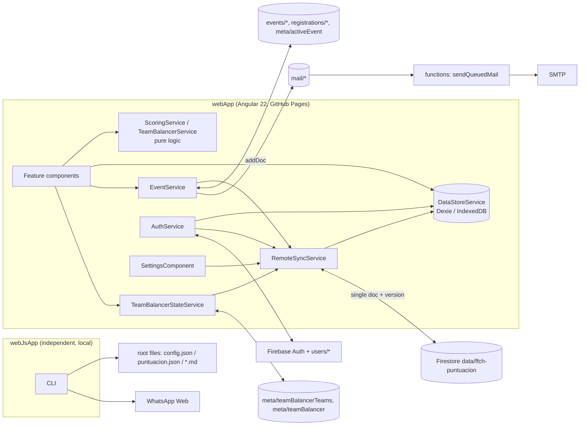

# Architecture review — FFCH Web Portal

Snapshot review, 2026-11. Sections 1–5 are the original review. Changes implemented since then are in section 6. Concise always-on context is in [.github/copilot-instructions.md](../.github/copilot-instructions.md).

> **Scope rule:** `webApp/` and `webJsApp/` are independent applications and must stay that way. They share no code, only data and content files at the repo root. Duplication *inside* one app is a refactoring target. The same logic existing in both apps is intentional, and it is listed here only so the two copies are kept consistent by hand.

## 1. Architecture summary



- The app is local-first. It reads from IndexedDB, and an admin pushes the whole dataset to a single Firestore doc as one batch.
- The Firestore rules are the only server-side authorization. The `isAdmin` getters in components only control what the UI shows.
- The CLI is a separate application. It never reads Firestore, it keeps its own roster in `puntuacion.json`, and it shares no code with the webApp.

## 2. Problem areas

### 2.1 Structural / correctness

| # | Problem | Where | Impact |
|---|---|---|---|
| S1 | **Optimistic concurrency is defeated.** `pushToFirestore` pulls the *current* remote version and then pushes against it, so `SyncConflictError` can only fire in a millisecond race. If two admins both edited locally, the last one to push silently overwrites the other. | [settings.component.ts](../webApp/src/app/features/settings/settings.component.ts#L396) | Data loss |
| S2 | **Stale read cache.** `autoSyncSharedDataIfNeeded` pulls only when the local tables are empty. Non-admin dashboards never refresh after their first login unless the user clears site data. | [auth.service.ts](../webApp/src/app/core/services/auth.service.ts#L192) | Wrong standings shown |
| S3 | **No dirty tracking.** Local edits (weekly capture, TDP, roster, ratings) are not flagged as unpushed, so nothing warns the admin before they navigate away or pull, and pulling then wipes those edits (`importAll` clears every table). | `DataStoreService.importAll`, all edit features | Data loss |
| S4 | **A page visit causes writes.** Opening TDP as an admin calls `applyRegistrationsToTdp()`, which writes to Firestore. | [tdp.component.ts](../webApp/src/app/features/tdp/tdp.component.ts#L77) | Unexpected side effects |
| S5 | **Seed-admin temp password is hard-coded** in the public JS bundle and in git. The bootstrap also lets any client write `meta/seedStatus` before it exists. | [auth.service.ts](../webApp/src/app/core/services/auth.service.ts#L29), `firestore.rules` | Security (only matters on a fresh project or if the admin never changed the password) |
| S6 | The **`data/ffch-puntuacion` write rule** accepts any shape from an admin, and the 1 MiB doc limit will eventually be reached as `weeklyRecords` grows by players × weeks. | `firestore.rules`, `RemoteSyncService` | Future outage |
| S7 | **Two rosters.** The webApp keeps players in Firestore, and the CLI keeps them in `puntuacion.json` (`wanombre`/`wanumber`, which is PII committed to git). This follows from the apps being separate, so the fix is data hygiene, not shared code. | root, `webJsApp/index.js` | Drift, privacy |
| S8 | **Config used as state.** The CLI rewrites `config.json` (`WEEK_NUMBER`), which leaves the tracked file dirty after every run. | `webJsApp/index.js` | Noisy diffs |
| S9 | `importJsonFile` runs `JSON.parse` with no validation and no try/catch, so a bad file throws an uncaught error. Also, `removePlayer` deletes from 3 tables outside a Dexie transaction. | [settings.component.ts](../webApp/src/app/features/settings/settings.component.ts#L420), [roster.component.ts](../webApp/src/app/features/roster/roster.component.ts#L86) | Partial state |

### 2.2 Duplicated code

**Within the webApp (refactoring targets):**

| Duplicate | Copies |
|---|---|
| `slugify` | [roster.component.ts](../webApp/src/app/features/roster/roster.component.ts#L7), [csv-import.service.ts](../webApp/src/app/core/services/csv-import.service.ts#L62) |
| Next-Thursday math (**different semantics**: today counts vs. today is skipped) | [weekly-capture.component.ts](../webApp/src/app/features/weekly-capture/weekly-capture.component.ts#L36) (`% 7`, today counts), [team-balancer.component.ts](../webApp/src/app/features/team-balancer/team-balancer.component.ts#L267) (`\|\| 7`, today is skipped) |
| Season start / week number | [team-balancer.component.ts](../webApp/src/app/features/team-balancer/team-balancer.component.ts#L274) (first Thursday of October), Convocatoria (`WEEK_NUMBER` typed by hand) |
| "Summaries + maxPoints + rating" | [dashboard.component.ts](../webApp/src/app/features/dashboard/dashboard.component.ts#L111), [team-balancer.component.ts](../webApp/src/app/features/team-balancer/team-balancer.component.ts#L77) (which computes `summarizePlayer` **twice** per player) |
| `errorMessage(error)` | settings, event (each with its own variant) |
| Blob download (`createObjectURL` + `<a>`) | `SettingsComponent.downloadCsv`, `exportJson` |
| Hard-coded venue/time/season text (`Coloso de Hillsboro`, `7:00 PM`, `Invierno`) | [convocatoria.component.ts](../webApp/src/app/features/convocatoria/convocatoria.component.ts#L42), [team-balancer.component.ts](../webApp/src/app/features/team-balancer/team-balancer.component.ts#L264) |
| Pago season (Apr–Sep) | [weekly-capture.component.ts](../webApp/src/app/features/weekly-capture/weekly-capture.component.ts#L43) only. Not in `SeasonConfig` |

**Within webJsApp (refactoring targets):**

| Duplicate | Copies |
|---|---|
| Next-Thursday math | `index.js` `getNextThursday`, `dateHandler.js` `getExpectedDate` (mutates its argument) |
| Template rendering | `index.js` `renderTemplate` (`{{K}}`, regex), `FileHandler.replaceVar` (`{k}`) |

**Across the two apps (intentional, keep consistent by hand, do not share code):**

| Logic | webApp | webJsApp |
|---|---|---|
| `{{KEY}}` template rendering | `MessageTemplateService.render` | `renderTemplate` |
| Next match day (Thursday), season and week number | weekly capture, team balancer | `getNextThursday`, season ranges in `config.json` |
| Venue, time, season text | hard-coded in Convocatoria and Equipos | `config.json` |

### 2.3 Performance

| # | Bottleneck | Where | Complexity |
|---|---|---|---|
| P1 | `summarizePlayer` filters **all** records and history for each player | `ScoringService.summarizePlayer`, called from dashboard and team balancer | O(P × (R + H)), ×2 in team balancer |
| P2 | One IndexedDB query per player (N+1) | [convocatoria.component.ts](../webApp/src/app/features/convocatoria/convocatoria.component.ts#L83) | P round-trips |
| P3 | `pendingAttendance` lists **every** event, then every registration subcollection, on each TDP visit and each admin registration | [event.service.ts](../webApp/src/app/core/services/event.service.ts#L165) | E + 1 Firestore reads, growing every year |
| P4 | `weeklyRecords.toArray()` loads the whole table just to get the distinct `fecha` values | weekly-capture, convocatoria | O(R); `orderBy('fecha').uniqueKeys()` uses the index |
| P5 | The whole dataset moves on every push and pull (single doc) | `RemoteSyncService` | Grows without bound |

The data is small today (around 40 players and around 50 weeks), so these issues don't hurt yet. P1 and P3 grow with history and are the first that will.

### 2.4 Maintainability risks

- `SettingsComponent` (446 lines, 6 injected services) mixes event CRUD, registrations, on-behalf registration, CSV/JSON import and export, and Firestore sync.
- `webJsApp/index.js` (825 lines) and `whatsappHandler.js` (746 lines) are single-file CLIs with no tests.
- No component specs. Only services have specs.
- ~~Team-balancer state is per device, so a second admin sees different restrictions and history.~~ **Mitigated (2026-11, see 6.1):** team-balancer state now lives in Firestore and updates live. Pending teams, history, and the last winner are in `meta/teamBalancerTeams`, which every signed-in user can read. Restrictions are in the admin-only `meta/teamBalancer`. Rating changes after a result are pushed to the shared data doc right away.
- The Dexie `users` table in v2 is dead.
- `MAX_PLAYERS_PER_GAME`, the pago months, the season start month, and the venue are hard-coded constants and are not part of `SeasonConfig`.

## 3. Refactoring strategies (ordered, each one keeps behavior the same)

1. **Extract `webApp/src/app/core/utils`** (webApp only; `webJsApp` keeps its own helpers). Add `slugify`, `toIsoDate`, `nextWeekday(date, weekday, {includeToday})`, `errorMessage`, and `downloadBlob`. Replace the copies with imports. Keep each caller's current today-counts/today-skipped semantics by passing the flag explicitly. Add unit tests that pin the current outputs.
2. **Add a batch scoring API** (`ScoringService.summarizeAll`) that groups by `playerId` once. Dashboard and team balancer call it, and `summarizePlayer` stays as a thin wrapper so specs keep passing.
3. **Fix the sync version handling (S1/S2/S3).** Store `remoteVersion` and a `dirty` flag in Dexie `settings`. Push against the stored version, not a fresh pull. On login, pull when the remote version is newer and the local copy isn't dirty.
4. **Split `SettingsComponent`** into `EventEditorComponent`, `EventRegistrationsComponent`, and `DataSyncComponent` (sync + JSON/CSV). Keep the route and template layout the same.
5. **Remove the write from page loads.** TDP shows pending attendance read-only for everyone, and the admin gets an explicit *Aplicar inscripciones* button (Ajustes already has one).
6. **Centralize league constants** (venue, time, pago months, season start, max players) in one `league.config.ts`. Later, move them into `SeasonConfig` so they sync.
7. **Hardening.** Remove the seed password: create the first admin manually in the console, or read the password from a prompt. Add shape and size checks to the `data/ffch-puntuacion` rule. Validate imported JSON. Wrap `removePlayer` in a transaction.
8. **CLI (inside `webJsApp` only).**
   - Drop `FileHandler.replaceVar` and use only `renderTemplate` (`{{KEY}}`), so the CLI and the root templates use one syntax.
   - Merge `getNextThursday` and `DateHandler.getExpectedDate`.
   - Move `WEEK_NUMBER` out of `config.json` into an ignored state file, or compute it from the season start date.
   - If you want one roster, the webApp's *Descargar JSON* export can be saved as a root data file for the CLI to read. That shares data, not code. Don't import webApp code.
9. **Scale the shared doc (only when it gets close to 1 MiB).** Split `weeklyRecords` into `seasons/{year}` docs. Do this behind `RemoteSyncService` so callers don't change.

## 4. Improved code (proposals)

### 4.1 `core/utils` (dedup, behavior-preserving)

```ts
// webApp/src/app/core/utils/text.ts
export function slugify(text: string): string {
  return (
    text
      .normalize('NFD')
      .replace(/[\u0300-\u036f]/g, '')
      .trim()
      .toLowerCase()
      .replace(/[^a-z0-9]+/g, '-')
      .replace(/^-+|-+$/g, '') || 'player'
  );
}

export function errorMessage(error: unknown): string {
  return error instanceof Error ? error.message : 'Error desconocido.';
}
```

```ts
// webApp/src/app/core/utils/dates.ts
export const THURSDAY = 4;

/** Local-time YYYY-MM-DD (avoids toISOString's UTC shift). */
export function toIsoDate(date: Date): string {
  const pad = (n: number) => String(n).padStart(2, '0');
  return `${date.getFullYear()}-${pad(date.getMonth() + 1)}-${pad(date.getDate())}`;
}

export function nextWeekday(from: Date, weekday: number, includeToday: boolean): Date {
  const result = new Date(from.getFullYear(), from.getMonth(), from.getDate());
  const delta = (weekday - result.getDay() + 7) % 7;
  result.setDate(result.getDate() + (delta === 0 && !includeToday ? 7 : delta));
  return result;
}
```

```ts
// webApp/src/app/core/utils/download.ts
export function downloadBlob(content: BlobPart, type: string, filename: string): void {
  const url = URL.createObjectURL(new Blob([content], { type }));
  const a = document.createElement('a');
  a.href = url;
  a.download = filename;
  a.click();
  URL.revokeObjectURL(url);
}
```

Usage: `WeeklyCaptureComponent.nextThursday()` → `toIsoDate(nextWeekday(new Date(), THURSDAY, true))`. `TeamBalancerComponent.getNextThursday(d)` → `nextWeekday(d, THURSDAY, false)`.

### 4.2 Batch scoring (P1, removes the dashboard/team-balancer duplication)

```ts
// ScoringService
summarizeAll(
  players: Player[],
  weeklyRecords: WeeklyRecord[],
  tdpHistory: TdpHistoryEntry[],
  config: SeasonConfig
): Map<string, PlayerScoreSummary> {
  const recordsBy = groupBy(weeklyRecords, (r) => r.playerId);
  const historyBy = groupBy(tdpHistory, (h) => h.playerId);
  return new Map(
    players.map((p) => [
      p.id,
      this.summarizePlayer(
        p.id,
        recordsBy.get(p.id) ?? [],
        historyBy.get(p.id) ?? [],
        config.weights,
        p.sedeTemporadaAnterior,
        config.ptsTemporadaAnteriorIncludedInSum,
        p.socioFundador
      )
    ])
  );
}

// core/utils/collections.ts
export function groupBy<T, K>(items: T[], key: (item: T) => K): Map<K, T[]> {
  const map = new Map<K, T[]>();
  for (const item of items) {
    const k = key(item);
    const list = map.get(k);
    if (list) list.push(item);
    else map.set(k, [item]);
  }
  return map;
}
```

`summarizePlayer` already filters by `playerId`, so the pre-grouped arrays give the same result and the cost drops from O(P × R) to O(P + R). In the team balancer, call it once and read both `maxPoints` and each candidate from the returned map.

### 4.3 Convocatoria card counts (P2, removes the N+1)

```ts
async recomputeCardCounts(): Promise<void> {
  const fecha = this.selectedFecha();
  if (!fecha) return;
  const [players, records] = await Promise.all([
    this.store.players.filter((p) => p.activo).toArray(),
    this.store.weeklyRecords.toArray()
  ]);
  const recordsBy = groupBy(records, (r) => r.playerId);
  let yellow = 0, redLate = 0, redPayment = 0;
  for (const player of players) {
    const playerRecords = recordsBy.get(player.id) ?? [];
    const score = this.scoring.computeWeeklyScores(playerRecords).find((s) => s.fecha === fecha);
    if (!score) continue;
    const record = playerRecords.find((r) => r.fecha === fecha);
    if (score.tarjetaAmarilla) yellow += 1;
    if (score.tarjetaRoja && record?.pago === false) redPayment += 1;
    else if (score.tarjetaRoja) redLate += 1;
  }
  this.cardCounts.set({ yellow, redLate, redPayment });
}
```

### 4.4 Real optimistic concurrency + stale-cache refresh (S1–S3)

**This changes behavior.** A push can now fail with the existing conflict message where it used to overwrite silently. That is the intended contract of `RemoteSyncService`, but get the owner's agreement before shipping it.

```ts
// DataStoreService
const REMOTE_VERSION_KEY = 'sync:remoteVersion';
const DIRTY_KEY = 'sync:dirty';

async getRemoteVersion(): Promise<number> {
  return Number(await this.getSetting(REMOTE_VERSION_KEY)) || 0;
}
async markSynced(version: number): Promise<void> {
  await this.setSetting(REMOTE_VERSION_KEY, String(version));
  await this.clearSetting(DIRTY_KEY);
}
async markDirty(): Promise<void> {
  await this.setSetting(DIRTY_KEY, 'true');
}
async isDirty(): Promise<boolean> {
  return (await this.getSetting(DIRTY_KEY)) === 'true';
}
```

```ts
// SettingsComponent.pushToFirestore
const data = await this.store.exportAll();
const newVersion = await this.remoteSync.push(data, await this.store.getRemoteVersion());
await this.store.markSynced(newVersion);

// SettingsComponent.pullFromFirestore (and AuthService on login)
if (await this.store.isDirty() && !confirm('Hay cambios locales sin guardar en Firestore. ¿Descartarlos?')) return;
const remote = await this.remoteSync.pull();
if (remote) {
  await this.store.importAll(remote.data);
  await this.store.markSynced(remote.version);
}
```

```ts
// AuthService.autoSyncSharedDataIfNeeded — refresh when remote is newer and nothing local is pending
const remote = await this.remoteSync.pull();
if (!remote) return;
if (remote.version > (await this.store.getRemoteVersion()) && !(await this.store.isDirty())) {
  await this.store.importAll(remote.data);
  await this.store.markSynced(remote.version);
}
```

Call `store.markDirty()` after each local write in roster, weekly capture, TDP, and team-balancer ratings. `applyRegistrationsToTdp` already merges onto the latest remote copy, so it should call `markSynced(newVersion)` only when the store wasn't dirty before.

### 4.5 Safe JSON import (S9)

```ts
async importJsonFile(event: Event): Promise<void> {
  const file = (event.target as HTMLInputElement).files?.[0];
  if (!file) return;
  try {
    const data = JSON.parse(await file.text()) as Partial<FfchData>;
    if (!Array.isArray(data.players) || !Array.isArray(data.weeklyRecords) || !Array.isArray(data.tdpHistory) || !data.seasonConfig) {
      this.statusMessage.set('El archivo JSON no tiene el formato esperado.');
      return;
    }
    await this.store.importAll(data as FfchData);
    this.statusMessage.set('Datos importados desde archivo JSON.');
  } catch (error) {
    this.statusMessage.set(errorMessage(error));
  }
}
```

### 4.6 Atomic player removal (S9)

```ts
async removePlayer(player: Player): Promise<void> {
  if (!this.isAdmin) return;
  await this.store.transaction('rw', [this.store.players, this.store.weeklyRecords, this.store.tdpHistory], async () => {
    await this.store.players.delete(player.id);
    await this.store.weeklyRecords.where('playerId').equals(player.id).delete();
    await this.store.tdpHistory.where('playerId').equals(player.id).delete();
  });
  await this.load();
}
```

## 5. Verification checklist for any refactor

- Run `cd webApp && npm test`. The scoring, CSV (including real-data), event-report, and team-balancer specs must stay green.
- Before and after the change, compare Dashboard standings against `FFCH_Puntuacion/FFCH - Puntuacion - 2026 Puntos.csv` for a few players.
- Rules changes: test in the Firestore emulator, or deploy to the `TEST` profile first.
- Run `cd webApp && npm run build`. The production build must succeed, since CI deploys on every push to `main`.

## 6. Implemented changes

### 6.0 Application boundaries and docs (2026-11)

- I checked that `webApp/` and `webJsApp/` share no code:
  - Neither imports from the other.
  - `webJsApp` reads only root files (`config.json`, `puntuacion.json`, `*.md`).
  - `webApp` reads only `FFCH_Puntuacion/` (the Ayuda docs and the CSVs in one spec).
- [webApp/README.md](../webApp/README.md) is now a Spanish user guide, which the in-app *Ayuda* page shows. The implementation details moved to the root [README.md](../README.md).

### 6.1 Shared team-balancer state (2026-11)

- [team-balancer-state.service.ts](../webApp/src/app/core/services/team-balancer-state.service.ts) owns two docs, both kept live with `onSnapshot`:
  - `meta/teamBalancerTeams` holds `{ pendingTeams, history, lastWinner }`. Every signed-in user can read it, and only admins can write it. `recordResult()` runs in a transaction that keeps the last 10 entries and clears the pending teams.
  - `meta/teamBalancer` holds `{ restrictions }`. Only admins can read or write it. Restrictions use `arrayUnion`/`arrayRemove`, so two admins editing at once don't lose each other's changes.
- **Live ratings.** After a result, the recording admin's device saves the ratings to Dexie as before. It then calls `pushRatings()`, which applies only the changed ratings to the latest `data/ffch-puntuacion` and pushes with that doc's version, the same pattern as `applyRegistrationsToTdp`. The ratings are pushed *before* the result is recorded. Other devices see the new history entry and call `pullRatings()`, which copies only the `rating` field into local Dexie, so their unpushed edits are kept.
- **Migrations, both run in transactions and both one-time:**
  - Team fields that an earlier build wrote into `meta/teamBalancer` are moved into `meta/teamBalancerTeams` and removed with `deleteField`.
  - If there are none, the old Dexie `team-balancer:*` settings are copied from the first admin device that opens Equipos. Those Dexie keys are left in place, unused.
- [team-balancer.component.ts](../webApp/src/app/features/team-balancer/team-balancer.component.ts) subscribes to the teams doc for everyone, and to restrictions only for admins. The restrictions section is hidden from non-admins. Both listeners are removed through `DestroyRef`.
- [firestore.rules](../webApp/firestore.rules) has one block per doc. Each block allows only that doc's keys, caps `history` at 10 entries, and blocks deletes.
- **Not covered:**
  - If a ratings push fails (offline, or a `SyncConflictError`), the result is still recorded and the ratings stay local. The user is told to use *Guardar en Firestore*.
  - `pendingTeams` uses last-write-wins.
  - Applying a result still writes `rating ?? 1` locally for players who never had a rating. That quirk is unchanged, and it is not pushed.
